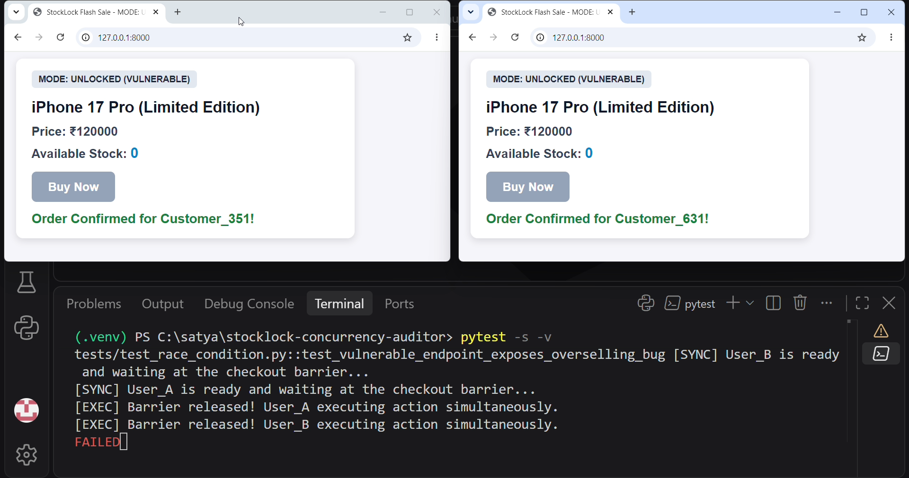
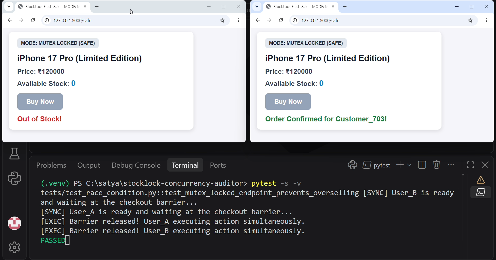
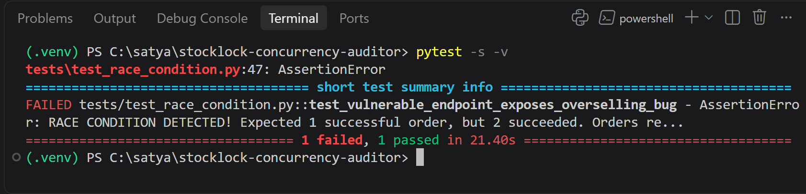

# StockLock Concurrency Auditor 🔒⚡

An automated **Multi-Context Race Condition & Inventory Integrity Auditing Framework** built with **Python, Playwright (Async API), Pytest, and FastAPI**.

## 🎯 Problem Statement
In high-traffic e-commerce flash sales, **Time-of-Check to Time-of-Use (TOCTOU)** race conditions occur when multiple users attempt to purchase the last available unit at the exact same millisecond. Standard sequential UI automation tests miss these critical concurrency defects.

## 🏗️ Architecture & Key Features

- **Isolated Multi-Context Execution (`conftest.py`)**: Spawns independent browser contexts (`User_A` and `User_B`) with separate cookies and session storage.

- **Deterministic Barrier Synchronization (`utils/sync_barrier.py`)**: Uses `asyncio.Barrier` to hold concurrent browser sessions at the checkout button and release them at the exact same instant.

- **Backend Ground-Truth Auditing (`utils/stock_auditor.py`)**: Cross-verifies UI order confirmations against backend inventory state via REST APIs to detect overselling.

- **Post-Mortem Traceability**: Automatically captures Playwright execution traces (`trace_user_a.zip`, `trace_user_b.zip`) and self-contained HTML audit reports.

## 📂 Project Structure
```text
stocklock-concurrency-auditor/
├── mock_app/               # FastAPI target app with Vulnerable (/) and Mutex-Locked (/safe) endpoints
├── pages/                  # Async Page Object Models (ProductPage, CheckoutPage)
├── utils/                  # ConcurrencyBarrier & StockAuditor utilities
├── tests/                  # Pytest async fixtures and race condition test suites
├── reports/                # Generated HTML audit reports and Playwright traces
└── requirements.txt        # Project dependencies

```
## 🚀 How to Run Locally

### 1. Create & activate virtual environment:
```
python -m venv .venv
.venv\Scripts\activate
```
### 2. Install dependencies & Playwright browser:
```
pip install -r requirements.txt
playwright install chromium
```
### 3. Start the Target Application (Terminal 1):
```
uvicorn mock_app.app:app --reload
```
### 4. Execute the Concurrency Audit Suite (Terminal 2): 
```
pytest -s -v --html=reports/audit_report.html --self-contained-html
```
## 📊 Expected Audit Output

​test_vulnerable_endpoint_exposes_overselling_bug: FAILS — Detects that 2 concurrent users successfully purchased a single-stock item (RACE CONDITION DETECTED!).

​test_mutex_locked_endpoint_prevents_overselling: PASSES — Confirms asyncio.Lock() serializes checkout requests, fulfilling only 1 order and rejecting the second user with "Out of Stock!".

---

## 📸 Live Audit Execution Proof

### 1. Unlocked Endpoint — Race Condition Overselling Detected (`FAILED`)


### 2. Mutex-Locked Endpoint — Concurrency Enforced (`PASSED`)


### 3. Final Pytest Audit Summary
